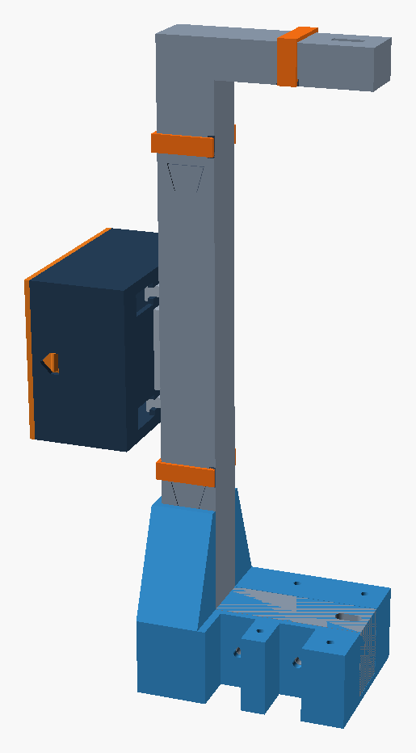

# Pinewood U v3 – Break-Beam Gate Holder

Version 3 of the 3D-printed U-frame that holds the Adafruit 2167 infrared
break-beam sensors above and below the track. It builds on the half-shell
concept (cables are laid in, not threaded) and fixes the issues found in the
first test prints. All dimensions are in millimetres.

**Assembly guide (PDF):** [English](assembly_guide_v3_en.pdf) · [Deutsch](assembly_guide_v3_de.pdf)



## What changed compared with the previous version

| Issue in the test print | v3 solution |
|---|---|
| Sensor slipped, no hold at the back | As in v1: the lens side sits in a snug **1 mm deep seat** (19.8 × 9.9 mm) and is clamped there. Behind it the pocket is open for the cables, with two narrow support ledges and 0.25 mm crush ribs. The back shell sets the position; the seat in the front shell is 0.15 mm larger per side so joining the shells does not tilt the sensor. A pry notch at the arm tip lets you lever the sensor out with a small screwdriver. |
| Female joints too thin, wobbly, hard to glue | Dovetail across the full spine depth (neck 12 / head 20 mm), socket walls ≥ 5.7 mm. Spine 32 × 31 mm, 8 mm outer wall per shell, cable channel stays 15 mm. Back and front shell are split at **staggered** heights, so every joint is covered and glued by the other shell. |
| Docking to the electronics housing had play | Stud in the keyhole ±0.1 mm and two wedge ramps per keyhole: the stud head sits with 0.1 mm preload in the end position. |
| U bottom too thin for clamping | Lower arm 40 mm thick and solid at the bottom. The sensor reference face and the beam path are unchanged. |
| Start stands on an inclined ramp and wobbles | Separate **start foot** (start only): a shoe around the U bottom with 25 mm flanges on both sides, flush under the track, plus 60 mm gussets on the spine. |
| Mounting without damaging cables | Two **printed bolt passages** across the lower arm: a solid Ø 12 mm tube bridges the cable channel, the cables run above it. 5.5 mm bore for an M5 bolt, the nut sits recessed in a hex pocket of the front shell. No extra parts besides bolts and nuts. |

## Mounting concept

Nothing printed is screwed into the track. Two metal angles per unit stay on
the track permanently. The U (at the start together with its foot) is bolted
sideways through the angles with two long M5 bolts. To swap a unit, undo the
2 bolts. The start foot has optional holes for 4 × 30 wood screws as a backup
only; if they are used, the foot has to be unscrewed as well to remove the U.

| Unit | Bolts |
|---|---|
| Finish | 2 × M5×40 + nut |
| Start | 2 × M5×45 + nut |

## Files

| File | Purpose |
|---|---|
| `pinewood_v3_shared.scad` | All dimensions and geometry. Change parameters here. |
| `pinewood_u_v3.scad` | Entry file for the frame shells, start foot, clips, test prints and previews (`variant`, `piece`, `segment`, `side`). |
| `electronics_housing_v3.scad` | Electronics housing (from v2, only the docking changed). |
| `assembly_views_v3.scad` | Views used for the images in the assembly guide (not a print file). |
| `export_stls_v3.sh` | Exports all STL files to `stl/`. |
| `stl/` | Ready-to-print STL files, left and right variants, in print orientation. |
| `assembly_guide_v3_en.pdf`, `assembly_guide_v3_de.pdf` | Assembly guide with parts list, exploded view and steps. Generated from `assembly_guide_v3.py`. |
| `design_sketch_v3_en.png`, `design_sketch_v3_de.png` | Schematic design sketch (SVG sources included), generated by `design_sketch_v3.py <out.svg> [en]`. |
| `images/` | Renders used by the guide and this README. |

## Parts per unit

| Part | STL (start) | Start | STL (finish) | Finish |
|---|---|---:|---|---:|
| Back shell | `start_<hand>_back_shell_seg1..3` | 3 | `finish_<hand>_back_shell_seg1..2` | 2 |
| Front shell | `start_<hand>_front_shell_seg1..3` | 3 | `finish_<hand>_front_shell_seg1..2` | 2 |
| Start foot | `start_<hand>_foot` | 1 | – | – |
| Spine clip | `spine_clip` | 2 | `spine_clip` | 2 |
| Upper arm clip | `arm_clip` | 1 | `arm_clip` | 1 |
| Electronics housing + lid | `housing_base`, `housing_lid` | 1 + 1 | `housing_base`, `housing_lid` | 1 + 1 |
| Docking lock plug | `dock_lock` | 2 | `dock_lock` | 2 |

`<hand>` is `left` or `right`; `right` is the complete mirror image. If the two
U-frames of a gate stand on opposite outer sides of the track, use one left and
one right frame per gate. Back and front shell are always both needed.

Test prints: `test_sensor_seat.stl` (both arm tips, both shells) and
`test_dovetail.stl`. Print these first.

## Printing

All STLs are exported in print orientation and need no supports. Recommended:
PETG, 0.4 mm nozzle, 0.2 mm layers, 4 perimeters, 25–35 % infill. The largest
part is 127 × 204 mm and fits a 250 mm bed.

## Regenerating

```bash
./export_stls_v3.sh                     # STL files -> stl/
python3 assembly_guide_v3.py            # guide HTML (print to PDF, A4)
python3 design_sketch_v3.py design_sketch_v3_en.svg en
```

The scripts expect `openscad` on the path (`OPENSCAD_BIN` overrides it).

## Assumptions to check on the real build

- Metal angles: 20 mm wide (`angle_w`), one angle per bolt, bolt spacing 35 mm (`bolt_pos`).
- The track edge is at the front face of the spine (X = 20). If the track reaches further towards the spine, reduce `foot_gusset_h`.
- The start foot is flat, not wedge-shaped.
- Sensor dimensions and press fit come from v1 and were confirmed with the v3 sensor test print.
- Checked in CAD: all STLs are closed single bodies with Z_min = 0, the assembled parts do not overlap (intended exceptions: crush ribs and wedge ramps), and the bolt path is clear. A full print with a load test is still pending.
