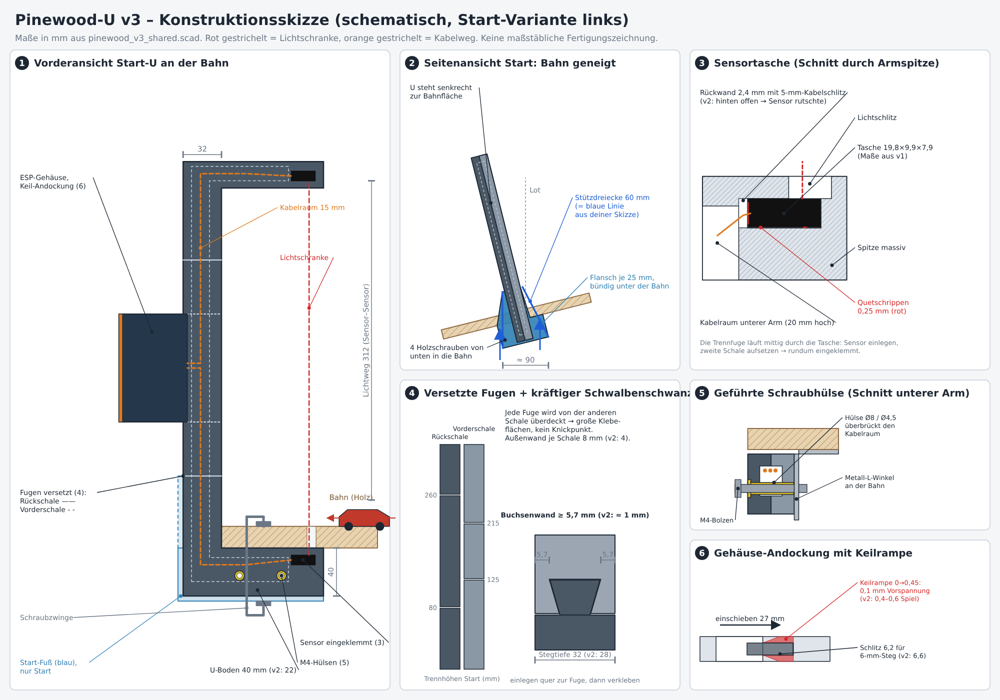

# Pinewood-U v3 – Lichtschranken-Halter

v3 baut auf dem Halbschalen-Konzept aus v2 auf (Kabel einfach einlegen) und
behebt die Probleme aus dem ersten Probedruck. v1 und v2 bleiben unverändert.

## Was sich gegenüber v2 ändert

| Problem im Probedruck | Lösung in v3 |
|---|---|
| Lichtschranke rutscht, hinten kein Halt | Sensortasche wieder rundum geschlossen wie in v1 (19,8 × 9,9 × 7,9 mm). Neue 2,4-mm-Rückwand mit nur 5 mm Kabelschlitz, Boden direkt unter dem Sensor. Vier 0,25-mm-Quetschrippen (2× Rückwand, 2× Boden) drücken den Sensor gegen Spitze und Linsenseite. Die Trennfuge läuft mittig durch die Tasche: Sensor einlegen, zweite Schale aufsetzen, fertig eingeklemmt. |
| Weibliche Steckverbindungen zu dünn, wacklig, schlecht klebbar | Schwalbenschwanz jetzt über die ganze Stegtiefe (Hals 12 / Kopf 20 mm), Buchsenwände ≥ 5,7 mm statt ≈ 1 mm. Steg 32 × 31 mm statt 28 × 23 mm, Außenwand je Schale 8 statt 4 mm, Kabelraum bleibt 15 mm. Vorder- und Rückschale sind **versetzt** geteilt, jede Fuge wird von der anderen Schale überdeckt und großflächig verklebt. |
| Andockung ans ESP-Gehäuse hat Spiel | Steg im Schlüsselloch ±0,1 mm (v2 ±0,3), Einführöffnung 12,4 mm (v2 12,6). Zwei Keilrampen je Schlüsselloch auf der Gehäuse-Innenwand: Der Zapfenkopf läuft beim Einschieben auf und sitzt in Endlage mit 0,1 mm Vorspannung. Kragen am Kabeldurchgang 0,1 mm statt 0,2 mm Luft. |
| U-Boden zu dünn zum Klemmen | Unterer Arm 40 mm dick (v2: 22 mm), unten massiv. Die Sensor-Bezugsfläche (Z = 20) und der Lichtweg bleiben gleich. |
| Start steht schräg und wackelt | Separater **Start-Fuß** (nur Start): Schuh um den U-Boden mit je 25 mm Flansch links/rechts (≈ 90 mm breit), bündig unter der Bahn, plus 60 mm hohe Stützdreiecke am Steg (die blaue Linie aus der Skizze). 4 Löcher für Holzschrauben von unten in die Bahn. Ziel braucht ihn nicht. |
| Schraubbefestigung ohne Kabelschaden | Zwei **geführte M4-Hülsen** (Ø 8 / Ø 4,5 mm, mit Bund) quer durch den unteren Arm. Sie überbrücken den Kabelraum, die Kabel laufen darüber vorbei. Gleichzeitig Passstift zwischen den Schalen. Ein Metall-L-Winkel an der Bahn kann mit 2 M4-Bolzen durch die Hülsen geschraubt werden. Beim Start gehen die Bolzen durch den Fuß mit. |

## Dateien

- `pinewood_v3_shared.scad` – alle Maße und Geometrie, hier anpassen.
- `pinewood_u_v3.scad` – U-Rahmen, Start-Fuß, Hülse, Klammern, Probedrucke, Vorschau.
- `gehaeuse_v3.scad` – Elektronikgehäuse (aus v2, nur Andockung geändert).
- `export_stl_v3.sh` – erzeugt alle STLs nach `stl/` (rechte Variante: `SIDE=right ./export_stl_v3.sh`).
- `konstruktionsskizze_v3.png/.svg` – schematische Skizze, erzeugt von `konstruktionsskizze_v3.py`.
- `render_start_*.png` – OpenSCAD-Ansichten der montierten und explodierten Start-Einheit.

## Druckliste je Einheit

| Teil | Start | Ziel |
|---|---|---|
| Rückschale (`schale0_seg*`) | 3 Segmente (Fugen bei Z 80 / 260) | 2 Segmente (Fuge bei Z 70) |
| Vorderschale (`schale1_seg*`) | 3 Segmente (Fugen bei Z 125 / 215) | 2 Segmente (Fuge bei Z 170) |
| `start_*_fuss` | 1 | – |
| `huelse_m4` | 2 | 2 |
| `spine_clip` / `arm_clip` | 2 / 1 | 2 / 1 |
| `gehaeuse_base`, `gehaeuse_lid` | je 1 | je 1 |
| `dock_lock` | 2 | 2 |

Größtes Einzelteil: Ziel-Vorderschale unten, 127 × 204 mm. Alles passt auf ein 250-mm-Bett.

## Drucken (supportfrei)

- **Schalen:** wie exportiert, breite Außenseite aufs Bett, Kabelraum und Sensortasche oben offen. Schwalbenschwanz, Hülsenbohrungen und Rippen wachsen senkrecht.
- **Start-Fuß:** Boden aufs Bett. Stützdreiecke werden nach oben schmaler, die waagerechten Bolzenlöcher sind tropfenförmig (45°-Dach). Einzige Brücke: der Absatz der Schraubensenkung (Ø 9 auf Ø 4,5).
- **Hülsen:** Bund unten.
- **Gehäuse, Deckel, Stopfen, Klammern:** wie in v2. Die neuen Keilrampen liegen flach auf der Rückwand.

Empfehlung wie v2: PETG, 0,4-mm-Düse, 0,2-mm-Schichten, 4 Perimeter, 25–35 % Infill.

## Erst Probedrucke

1. `test_sensortasche` (beide Halbschalen der unteren Armspitze): Sensor einlegen, zweite Hälfte aufsetzen. Er soll ohne Wackeln sitzen. Zu stramm: `sensor_crush` auf 0,15 setzen. Zu locker: 0,35.
2. `test_schwalbenschwanz`: Segmente quer zur Fuge ineinanderlegen. Klemmt es: `fit` auf 0,35.
3. Andockung am fertigen Gehäuse prüfen. Zu stramm: `dock_ramp_h` 0,4. Noch Spiel: 0,5.

## Montage

1. Je Schale die Segmente quer zur Fuge (Y) ineinanderlegen und verkleben.
2. Sensoren in die Taschen der Rückschale legen, Kabel durch den Schlitz in den Kabelraum, Stecker im Steg. Kabel im unteren Arm **über** die Hülsen führen.
3. Hülsen von außen durch die Rückschale stecken (Bund in der Senkung).
4. Vorderschale aufsetzen (Passstifte + Hülsen führen), großflächig verkleben, Klammern aufschieben.
5. Gehäuse wie in v2 auf die Zapfen setzen und 27 mm einschieben, bis es fest auf den Keilrampen sitzt, dann die beiden Stopfen setzen.
6. **Start:** U in den Fuß stellen, Fuß von unten an die Bahn schrauben, ggf. M4-Bolzen durch Fuß und Hülsen. **Ziel:** L-Winkel an die Bahn und mit 2 M4-Bolzen durch die Hülsen. Zusätzlich mit Zwingen über die 40-mm-Fläche klemmen.

## Annahmen, bitte am Aufbau prüfen

- Die Bahnkante liegt an der Stegvorderseite (X = 20). Ragt die Bahn weiter an den Steg heran, stören die Stützdreiecke: `foot_gusset_h` verkleinern oder auf 0 setzen.
- Der Fuß ist gerade, nicht keilförmig. Ein schräger Boden für einen festen Rampenwinkel wäre eine kleine Erweiterung, sobald der Winkel bekannt ist.
- Sensormaße und Klemmsitz stammen aus v1. Das echte Sensorgehäuse habe ich nicht vermessen.
- Geprüft per CAD: Alle STLs sind geschlossene Einzelkörper mit Z_min = 0. Die Teile überschneiden sich in der Montage nicht (Schalen, Hülsen, Fuß, Klammern, Gehäuse, Deckel). Gewollte Ausnahmen sind nur Quetschrippen und Keilrampen. Ein echter Druck mit Belastungstest steht noch aus.
